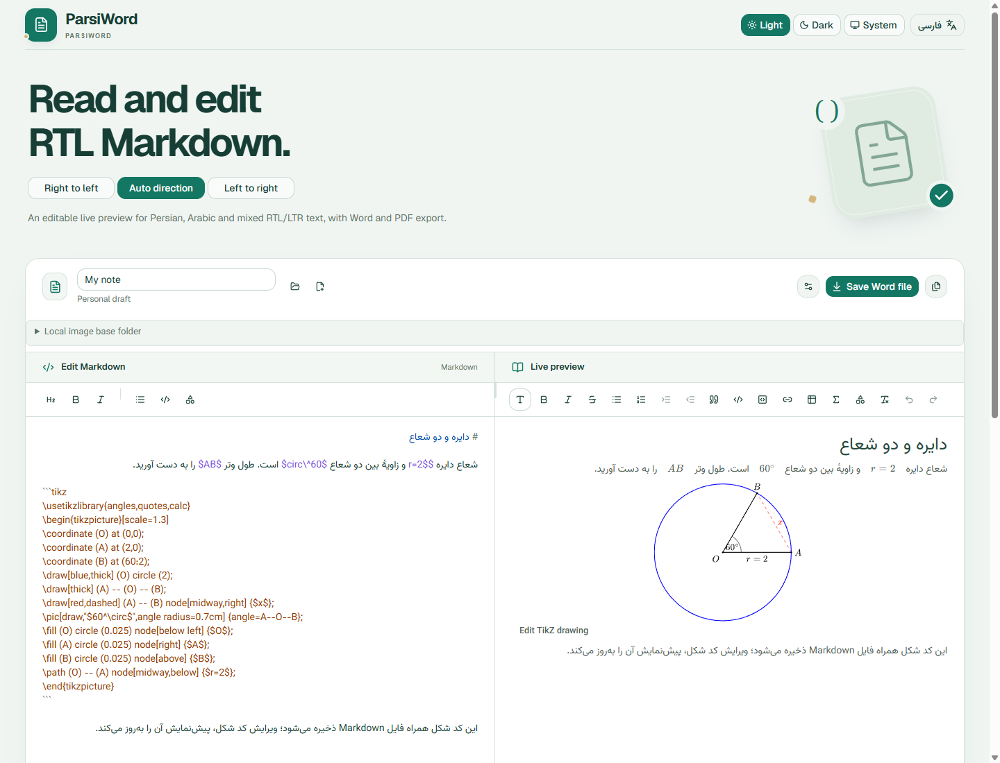

# ParsiWord · پارسی‌ورد

**An RTL Markdown editor and viewer with an editable live preview, Word/PDF export, and tools for mathematics.**

Write Persian, Arabic, English, and mixed RTL/LTR documents in Markdown. Edit the source or the rendered result, draw geometry with TikZ, and export your work on your own device.

[](https://github.com/SoroushJM/ParsiWord/actions/workflows/pages.yml)
[](https://github.com/SoroushJM/ParsiWord/actions/workflows/vscode.yml)

[**Open the web app**](https://soroushjm.github.io/ParsiWord/en/) · [**نسخهٔ فارسی**](https://soroushjm.github.io/ParsiWord/) · [**Downloads**](https://github.com/SoroushJM/ParsiWord/releases) · [فارسی](#persian) · [Report an issue](https://github.com/SoroushJM/ParsiWord/issues)



*The web editor running locally with the [geometry example](examples/tikz-geometry.md). The interface language and document direction are independent.*

## Why ParsiWord?

Persian and Arabic Markdown need more than right-aligned paragraphs. A document can mix RTL prose with English names, numbers, links, code, and equations. ParsiWord brings source editing, an editable rendered view, and document export into one workflow designed around that mix.

Use it for technical documentation, study notes, user guides, and mathematics question sheets. The same editor and conversion core powers the website, VS Code extension, and native apps.

## Use it now

| Platform | Start here |
| --- | --- |
| **Web** | [English](https://soroushjm.github.io/ParsiWord/en/) or [فارسی](https://soroushjm.github.io/ParsiWord/) — no installation. |
| **VS Code** | Download `parsiword-vscode-*.vsix` from [GitHub Releases](https://github.com/SoroushJM/ParsiWord/releases), then choose **Extensions → Install from VSIX…**. |
| **Android** | Download the Preview `.apk` from [GitHub Releases](https://github.com/SoroushJM/ParsiWord/releases). Android 7+; ARM64 only. |
| **Windows** | Download the `*_x64-setup.exe` installer from [GitHub Releases](https://github.com/SoroushJM/ParsiWord/releases). |

Native downloads are **Preview releases**. Each release includes build information and SHA-256 checksums. Linux, macOS, and iOS build targets are also present in the source; see the [platform guide](docs/platforms.md) for requirements and recorded validation.

### Write, preview, and export

1. Open a Markdown file or start writing. In the web app, your draft is saved in the current browser.
2. Choose **RTL**, **LTR**, or **Auto** for the document. You can switch the interface language separately.
3. Edit the source or the live preview. On desktop, both panes are visible; on mobile, switch between them with the editor tabs.
4. Choose your output font and size, then save **Word**, **PDF**, or **Markdown**.

## Website features

### Documents and editing

- **Open local files:** import Markdown or plain text (`.md`, `.markdown`, `.txt`) and choose the document title used for exported filenames.
- **Start fresh or restore:** **New note** opens an empty document. **Restore previous text** brings back the text replaced by opening a file or starting a note during the current session.
- **Local autosave:** keep the current draft and output settings in the browser. The status bar shows saving/saved/storage-error state, word count, and character count. Clearing browser data removes the stored draft and downloaded fonts.
- **An editable preview:** type directly into formatted paragraphs, headings, lists, and table cells. Changes update the Markdown source; small rich edits preserve unrelated source spelling, spacing, escapes, and line endings.
- **Markdown toolbar:** insert headings, bold, italic, list markers, inline code, or a starter TikZ drawing around the current source selection.
- **Rich formatting toolbar:** paragraph and heading levels 1–6, bold, italic, strikethrough, bulleted and numbered lists, list indent/outdent, block quotes, inline code, code blocks, links, tables, equations, TikZ insertion, clear formatting, Undo, and Redo.
- **Table editing:** insert a table, edit cells, add or remove rows and columns, or delete the table. GFM table alignment is preserved in the document model and exports.
- **Readable tables on small screens:** short columns stay compact, longer prose wraps at a readable width, and wide tables scroll inside their own frame. Long formulas retain their natural size and get an independent horizontal ScrollArea when wider than the preview pane; large images fit proportionally. These are preview/editing rules; Word/PDF use their existing page layout.
- **Markdown structure:** nested lists, checklists, quotes, thematic breaks, inline and reference-style links/images, and explicit hard breaks. Ordinary source newlines flow within a paragraph; explicit hard breaks remain visible.
- **Starter document:** the first visit includes mixed Persian/English text, formulas, Mermaid, TikZ, and code samples. Existing drafts, including intentionally empty ones, are preserved.
- **Sample library:** the small library icon in the footer (in VS Code, the editor status row) opens 16 named examples, including wide/incomplete tables and previous bug reproductions. Expectations are written beside the example in its Markdown. Search examples, save the current text as a named personal sample on this device, or delete a personal sample. Loading a sample replaces the document as one separate Undo/Redo step; ordinary editing and autosave continue.

### RTL, languages, and layout

- **RTL / LTR / Auto:** choose a fixed writing direction or detect each paragraph independently. Code remains LTR, and math has its own layout.
- **Persian and English interfaces:** switch language without changing the document's content, direction, title, or draft.
- **Desktop split view:** source and preview appear side by side with a draggable divider that also supports keyboard adjustment.
- **Synchronized reading:** scrolling either pane reveals corresponding source blocks in the other. Selecting text highlights its counterpart without moving keyboard focus.
- **Mobile editing:** sticky edit/preview tabs show one pane at a time and retain reading position and selection when switching. Formatting tools remain available while scrolling.
- **Themes:** open **Theme** beside settings for Neutral, Navy, Paper or Soft purple, each with independent light/dark palettes and Light/Dark/System mode. Customize interface, source, preview, Markdown and code colors using any CSS color format supported by your runtime. Preview live, save/cancel/reset, keep named themes, and import/export JSON on the same device. VS Code follows its host theme by default and also supports independent themes. Word/PDF retain their print colors; Git and linked-selection decorations keep their meaning.
- **Accessible controls:** labeled icon buttons, keyboard focus, accessible dialogs, and a readable native source-input fallback during text composition or forced-colors display.

### Fonts and output settings

- Set the document title, RTL/LTR/automatic direction, font family, and text size. Sizes **10, 11, 12, 14, 16, and 18 pt** are shared by Word and PDF.
- Use bundled **Vazirmatn** for Persian, **Noto Sans Mono** for code, and **STIX Two Math** for equations, with a fallback font for supported rare symbols.
- Search a bundled catalogue of **1,949 Google Fonts families**. Filter by Persian/Arabic support, downloaded fonts, or all fonts; load more results as needed.
- Download only the selected font and its available regular/bold faces. Reuse cached fonts, remove downloaded fonts, or refresh the catalogue. In the website, refresh reads the catalogue snapshot published with the app.
- Embed the fonts actually used in Word and PDF. Latin-only document fonts use Vazirmatn for Persian text. Font requests do not include document text; embedded-font display still depends on the reader application.

### Images

- Display inline and reference-style Markdown images in the editable preview, including relative paths and online URLs. Use the image's **Edit image** control to edit its Markdown source.
- In the website's **Local image base folder**, select the document or project folder, set the document's subfolder when needed, change the selection, or clear access. A compatible folder picker is available when the browser's directory API is unavailable.
- Resolve paths such as `./images/circle.png` and `../images/circle.svg` inside the selected folder. Folder access must be selected again after reloading; typing a computer path alone does not grant access.
- Embed the actual image bytes in Word/PDF, including images within lists and tables. **PNG, JPEG, GIF, WebP, AVIF, BMP, and SVG** are normalized to embedded PNG; animations become a still frame.
- Preserve aspect ratio and fit images to page or table-cell bounds. The exported file no longer depends on the original local image files.

Online images must allow CORS for web export. Unavailable preview images retain alternative text; missing or invalid export images stop conversion with an explanation. Folder contents are not uploaded.

### Code, equations, and diagrams

| Content | Input | Preview and editing |
| --- | --- | --- |
| **Highlighted code** | A code fence with a language such as `typescript` or `python` | Syntax colors and a language label; unrecognized languages remain plain text. |
| **LaTeX equations** | `$...$`, `$$` on separate lines, or `math` / `tex` / `latex` fences | Fractions, roots, powers, sums, integrals, matrices, and other supported KaTeX expressions. Select an equation to edit its LaTeX. |
| **Mermaid** | A `mermaid` fence | Flowcharts, sequence diagrams, and other engine-supported diagrams; edit the diagram source from the preview. Wide diagrams can be scrolled horizontally. |
| **TikZ and PGFPlots** | A `tikz` or `tikzpicture` fence | Real local TeX/PGF compilation for geometry and plots. Edit the source in a draft dialog; Apply updates the document, Cancel leaves it unchanged. |
| **Full Persian LaTeX documents** | A `xelatex` or `latex-document` fence; `latex` / `tex` with `\documentclass` also works | Local XeLaTeX/XePersian compilation, Persian text and labels, multi-page preview, and expandable compiler logs when a document fails. |

<details>
<summary>All 36 bundled code languages</summary>

`bash`, `c`, `cpp`, `csharp`, `css`, `diff`, `go`, `graphql`, `ini`, `java`,
`javascript`, `json`, `kotlin`, `less`, `lua`, `makefile`, `markdown`, `objectivec`,
`perl`, `php`, `php-template`, `plaintext`, `python`, `python-repl`, `r`, `ruby`,
`rust`, `scss`, `shell`, `sql`, `swift`, `typescript`, `vbnet`, `wasm`, `xml`, `yaml`.

Aliases include `html`/`xml` and `jsx`/`javascript`. Highlighting runs locally in the preview and Word output. See the [highlighting guide](docs/code-highlighting.md).

</details>

### Try a geometry question

Paste this into ParsiWord:

````markdown
# دایره و دو شعاع

شعاع دایره $r=2$ و زاویهٔ بین دو شعاع $60^\circ$ است.
طول وتر $AB$ را به دست آورید.

$$
AB = 2r\sin\left(\frac{\theta}{2}\right)
$$

```tikz
\begin{tikzpicture}
\coordinate (O) at (0,0);
\coordinate (A) at (2,0);
\coordinate (B) at (60:2);
\draw[blue,thick] (O) circle (2);
\draw (A)--(O)--(B);
\draw[red,dashed] (A)--(B) node[midway,right] {$x$};
\node[below] at (O) {$O$};
\node[right] at (A) {$A$};
\node[above] at (B) {$B$};
\end{tikzpicture}
```
````

For a complete Persian exam sheet, use the XeLaTeX/XePersian path with the bundled font filenames. The curated runtime includes LaTeX, XePersian, bidi, fontspec, amsmath/amssymb, TikZ/PGF, PGFPlots, geometry, and enumitem. No local TeX installation or remote compiler is required. The larger engine loads only when needed; the first web download is about 33 MB.

[TikZ guide](docs/tikz.md) · [Geometry example](examples/tikz-geometry.md) · [XeLaTeX/XePersian guide](docs/xelatex.md) · [Complete Persian exam example](examples/xepersian-exam.md)

### Word, PDF, and Markdown exports

| Content | Word (DOCX) | PDF |
| --- | --- | --- |
| Markdown text, headings, lists, tables, and code | Editable document content with embedded fonts | Searchable text with embedded fonts |
| Ordinary LaTeX equations | Editable Word equations | Rendered images |
| Markdown images, Mermaid, and standalone TikZ drawings | Embedded images | Embedded images |
| Complete XeLaTeX/XePersian documents | A page image for each compiled page, with source metadata | Original vector PDF pages, with text extraction |

- **Shared settings:** title, direction, font, and text size apply to both document formats. Pages use A4 with consistent margins; long content is paginated.
- **UTF-8 Markdown:** save the current logical source without a BOM, preserving its escapes and line endings. Empty Markdown documents can be saved too.
- **Current content:** export uses the current document and settings, including recent edits. A display theme never changes the printed colors.
- **Local conversion:** the website creates real downloadable files without a conversion server or a print-dialog dependency.
- **Explicit failures:** invalid formulas, diagrams, missing images, and oversized output report errors instead of silently dropping content.

The live preview is an editing view rather than a simulation of Word pagination. Text inside an exported image is not editable Word text. See the [export guide](docs/pdf-export.md) for details.

### AI writing guide

The small AI prompt button in the website footer copies a guide describing the supported Markdown, math, diagrams, image paths, and export rules. Give it to an AI assistant when asking it to prepare a document for ParsiWord, then paste the result into the editor. It copies instructions in the interface language; it does not send your document to an AI service.

## VS Code

After installing the VSIX, open a Markdown file and use **Reopen Editor With…** to choose:

- **ParsiWord Source + Result** — Markdown source and editable preview together; the default.
- **ParsiWord Markdown Source** — the RTL-friendly source editor.
- **ParsiWord Rendered Result** — direct editing of the rendered document.

The views share the VS Code document, saving, backups, and native Undo/Redo. Common shortcuts include Ctrl+S, Ctrl+Z, Ctrl+F, Ctrl+H, and Ctrl+G; Quick Open, Command Palette, and tab-switching shortcuts remain available. The extension follows the VS Code theme, including High Contrast.

**Git diff** compares the index and working file; **Staged diff** compares HEAD and the index. Both open one ParsiWord comparison tab. Choose source or rendered output, then **Side by side** with synchronized scrolling or **Inline**. Added and removed content is highlighted, change navigation is available, and the working file remains editable. **VS Code Diff** opens the same revisions in the built-in text comparison when you need it.

Local image paths resolve relative to the Markdown file. Native VS Code source and preview commands remain available. See the [extension guide](apps/vscode/README.md) for the full shortcut table, comparison behavior, installation, and recovery handling.

## Local processing and supported scope

Document editing, conversion, and TeX compilation run on your device. Document text is not sent to a conversion server. The website still needs its application assets on an initial visit; it does not install an offline copy through a service worker. Downloading additional fonts or loading online images makes network requests.

- **Markdown and HTML:** Markdown structure is supported; arbitrary HTML layouts, CSS, and scripts are not executed. Raw HTML is preserved as literal source.
- **TeX:** the bundled engines provide a curated package set, not all of TeX Live. Arbitrary packages, system fonts, external files, and shell-based toolchains are outside that set. XeLaTeX blocks are limited to 50,000 source characters and up to 12 preview pages, subject to execution and memory limits.
- **Document size:** rich editing supports up to 500,000 Markdown characters. Oversize recovered documents retain their source while rich preview is paused.
- **VS Code features:** multi-cursor editing is not implemented in the ParsiWord editor. The built-in source editor remains available for it and for other Markdown extensions.
- **Native validation:** a supported build target is distinct from testing on a real device. The [platform guide](docs/platforms.md) records requirements and validation limits.

## Development

Use **Node.js 24** and **pnpm 10.17.0**, matching the repository's CI and `packageManager` setting.

```sh
npm install -g pnpm@10.17.0
git clone https://github.com/SoroushJM/ParsiWord.git
cd ParsiWord
pnpm install --frozen-lockfile
pnpm run dev
```

Open **http://localhost:1420/**. Run all commands below from the repository root.

The sample library is enabled in production by default and loaded on demand.
Set `VITE_SAMPLE_LIBRARY=false` when building to omit its entry, code and built-in
documents entirely. Personal samples remain in local storage. For example, in
PowerShell: `$env:VITE_SAMPLE_LIBRARY='false'; pnpm run build`. Remove that
environment override to restore the default. The decision and behavior are recorded
in [ADR 0011](docs/adr/0011-responsive-tables-and-sample-library.md).

| Command | Purpose |
| --- | --- |
| `pnpm run build` | Type-check and build the website into `dist/`. |
| `pnpm run preview` | Serve the production web build locally. |
| `pnpm test` | Run the unit tests. |
| `pnpm run check:architecture` | Check shared-core API and dependency boundaries. |
| `pnpm run test:ui` | Run browser integration tests; install Chromium first with `pnpm exec playwright install chromium`. |
| `pnpm exec playwright test --config playwright.production.config.ts` | After `pnpm run build`, test responsive tables and the sample library against the local production build. |
| `node scripts/check-sample-library-build.mjs enabled dist` | Verify library assets are included; use `disabled <directory>` to verify a build made with `VITE_SAMPLE_LIBRARY=false`. |
| `pnpm run package:vscode` | Build a VSIX in `artifacts/parsiword-vscode-<version>.vsix`. |
| `pnpm run test:vscode` | Run integration tests in an isolated VS Code profile. |
| `pnpm run samples:build` / `pnpm run samples:check` | Regenerate or verify the starter document after changing its sources. |
| `pnpm run ui:capture` | Capture the running web interface; see the [capture guide](docs/ui-capture.md). |

Native builds additionally require Rust and the platform's Tauri toolchain:

| Target | Command | Requirements |
| --- | --- | --- |
| Android ARM64 | `pnpm run android:apk` | Android SDK/NDK, JDK, and signing configuration. See [Android packaging](docs/android-packaging.md) for signed Preview builds. |
| Windows | `pnpm run windows:build` | MSVC build tools and WebView2. |
| Linux | `pnpm run linux:build` | GTK/WebKitGTK development dependencies. |
| macOS | `pnpm run macos:build` | macOS and Xcode command-line tools. |
| iOS | `pnpm run ios:init`, then `pnpm run ios:build` | macOS, Xcode, and device signing/provisioning. |

### Repository layout

```text
packages/core/      Shared editor, RTL handling, Markdown, renderers, and exports
apps/parsiword/     Bilingual website and Tauri desktop/mobile application
apps/vscode/        VS Code extension host and webview
examples/          Markdown geometry and Persian exam examples
tests/             Browser integration tests and fixtures
docs/              Feature guides, architecture decisions, and validation records
third-party/       TeX runtime provenance and upstream source archives
```

GitHub Actions deploys the website through [`pages.yml`](.github/workflows/pages.yml). [`release.yml`](.github/workflows/release.yml) builds Android, Windows, and VS Code packages and attaches them to a Preview release identified by the source commit. See the [Pages guide](docs/github-pages.md) and [platform guide](docs/platforms.md) for configuration.

## Documentation

- [Word/PDF and Markdown export](docs/pdf-export.md)
- [LaTeX, Mermaid, and rich content](docs/rich-content.md)
- [TikZ and PGFPlots](docs/tikz.md)
- [Full Persian LaTeX documents](docs/xelatex.md)
- [Syntax highlighting](docs/code-highlighting.md)
- [VS Code usage](apps/vscode/README.md)
- [Platform builds and releases](docs/platforms.md)
- [Core API](docs/core-api.md), [Markdown contracts](docs/markdown-contracts.md), and [architecture decisions](docs/adr/)

## Third-party software and fonts

ParsiWord uses React, Tiptap/ProseMirror, remark, Tailwind CSS, shadcn/ui, Tauri, docx, PDFKit, KaTeX, Mermaid, and local TeX runtimes. Attributions and upstream licenses are retained with the [libraries](packages/core/public/licenses/NOTICE.txt), [fonts](packages/core/public/fonts/FONT-SOURCES.txt), [TikZ runtime](third-party/tikz/README.md), and [XeLaTeX runtime](third-party/xetex/README.md).

<a id="persian"></a>

## فارسی — ویرایشگر Markdown راست‌به‌چپ

**پارسی‌ورد برای دیدن و ویرایش Markdown فارسی، عربی و متن ترکیبی فارسی/انگلیسی ساخته شده است.** در یک محیط، منبع و خروجی قالب‌بندی‌شده را بخوان و ویرایش کن، فرمول و شکل بنویس و فایل Word یا PDF بگیر.

[**شروع در مرورگر**](https://soroushjm.github.io/ParsiWord/) · [**دانلود اندروید، ویندوز و افزونهٔ VS Code**](https://github.com/SoroushJM/ParsiWord/releases)

| بخش | امکانات |
| --- | --- |
| **نوشتن و فایل‌ها** | باز کردن Markdown و متن ساده، یادداشت تازه، نام سند، بازگرداندن متن قبلی در همان جلسه، ذخیرهٔ خودکار محلی، شمارش واژه و نویسه و وضعیت ذخیره. |
| **ویرایش دوطرفه** | ویرایش منبع و پیش‌نمایش یک سند مشترک، رنگ‌آمیزی Markdown، اسکرول هماهنگ، نمایش متن متناظر هنگام انتخاب، حفظ بخش‌های نامرتبط منبع در ویرایش‌های کوچک. |
| **قالب‌بندی** | تیترهای ۱ تا ۶، پررنگ، مورب، خط‌خورده، فهرست شماره‌دار و بولت‌دار و تورفتگی، چک‌لیست Markdown، نقل‌قول، کد، پیوند، پاک‌کردن قالب‌بندی و Undo/Redo. |
| **جدول** | درج و ویرایش جدول، افزودن و حذف ردیف و ستون و حذف کل جدول؛ عرض بر اساس محتوا، شکستن متن بلند، اسکرول داخلی جدول عریض و اسکرول مستقل فرمول خیلی بلند با ScrollArea. |
| **زبان و ظاهر** | رابط فارسی و انگلیسی، جهت راست‌به‌چپ/چپ‌به‌راست/خودکار، تم روشن/تیره/سیستم، تقسیم پنل‌های دسکتاپ و تب‌ها و ابزار چسبان موبایل. |
| **فونت** | وزیرمتن و فونت کد و ریاضی همراه، جست‌وجو در ۱٬۹۴۹ خانوادهٔ Google Fonts، فیلتر فارسی/عربی و فونت‌های ذخیره‌شده، دریافت، نگهداری و حذف فونت، اندازه‌های ۱۰ تا ۱۸ پوینت و جاسازی فونت در خروجی. |
| **تصاویر** | تصویر محلی، اینترنتی و reference-style، انتخاب پوشهٔ پایه و مسیر زیرپوشه، ویرایش نشانه‌گذاری تصویر، حفظ نسبت ابعاد و جاسازی واقعی در Word/PDF. |
| **کد** | رنگ‌آمیزی ۳۶ زبان در پیش‌نمایش و Word؛ متن کد در Word قابل‌ویرایش است. |
| **ریاضی و نمودار** | فرمول LaTeX، ویرایش فرمول از پیش‌نمایش، نمودار Mermaid، شکل هندسی TikZ، نمودار PGFPlots و سند کامل فارسی با XeLaTeX/XePersian. |
| **خروجی** | Word، PDF و Markdown، تنظیم مشترک نام و جهت و فونت و اندازه، کاغذ A4، فونت و تصویر جاسازی‌شده و تبدیل روی دستگاه. |
| **راهنمای AI** | دکمهٔ کوچک فوتر، پرامپت فارسی یا انگلیسیِ قابلیت‌ها و قواعد نوشتن سند را کپی می‌کند تا به دستیار AI بدهی. |
| **متن‌های نمونه** | آیکن کوچک کتابخانه در فوتر، و در VS Code در نوار وضعیت ادیتور؛ ۱۶ نمونهٔ آماده با انتظارِ نوشته‌شده در خود متن، جست‌وجو و ذخیره/حذف نمونهٔ شخصی روی دستگاه. انتخاب نمونه یک تغییر مستقل قابل Undo/Redo است. با `VITE_SAMPLE_LIBRARY=false` هنگام ساخت، کل ماژول و متن‌های آماده از خروجی حذف می‌شوند. |
| **VS Code** | سه نمای ویرایش، تاریخچه و ذخیرهٔ بومی، میان‌برهای رایج، مقایسهٔ Git برای منبع و خروجی رندرشده با حالت کنارهم و یکپارچه، هایلایت تغییرات، اسکرول هماهنگ و دسترسی به مقایسه‌گر خود VS Code. |

برای طراحی سؤال، [نمونهٔ دایره و دو شعاع](examples/tikz-geometry.md) و [نمونهٔ آزمون فارسی](examples/xepersian-exam.md) را ببین. فرمول‌های معمولی در Word قابل‌ویرایش‌اند؛ نمودارها و تصاویر به‌صورت تصویر جاسازی می‌شوند. سند کامل XePersian در Word به تصویر صفحه تبدیل می‌شود و متن داخل آن تصویر قابل‌ویرایش نیست؛ در PDF، صفحات برداری اصلی حفظ می‌شوند.

متن سند برای تبدیل به سرور ارسال نمی‌شود. دریافت فایل‌های برنامه، فونت‌های اضافی یا تصاویر آنلاین به اینترنت نیاز دارد. موتور TeX مجموعهٔ مشخصی از بسته‌ها و فونت‌ها دارد؛ محدودیت‌ها در [راهنمای XeLaTeX](docs/xelatex.md) آمده‌اند. نسخه‌های بومی از بخش **Releases** دریافت می‌شوند؛ اندروید فقط ARM64 است.

---

Built by [SoroushJM](https://github.com/SoroushJM) · [Source](https://github.com/SoroushJM/ParsiWord) · [Issues and feature requests](https://github.com/SoroushJM/ParsiWord/issues)
