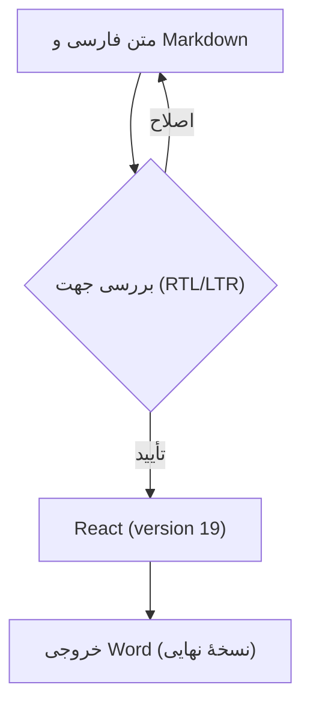
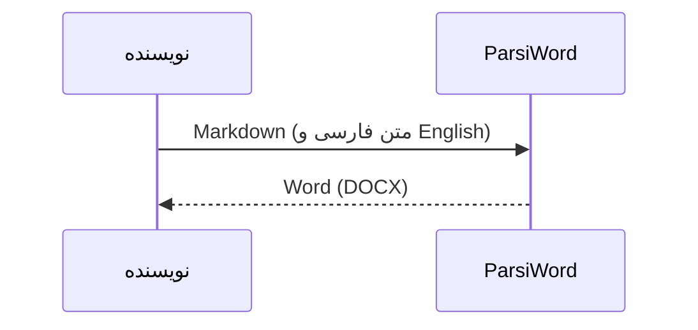

# فارسی و English؛ کنار هم

با پارسی‌ورد، Markdown راست‌به‌چپ را بنویس و همان‌جا ویرایش کن؛ از سؤال‌های هندسه با **TikZ** تا فرمول‌های پیشرفتهٔ **LaTeX**، جدول و نمودار.

Write and preview RTL Markdown, draw geometry with TikZ, and edit advanced LaTeX equations alongside Persian and English text.

## هندسه با TikZ؛ دایره، دو شعاع و یک سؤال

**صورت سؤال:** شعاع دایره $r=2$ و زاویهٔ بین دو شعاع $60^\circ$ است. طول وتر $AB$ را به دست آورید.

```tikz
\usetikzlibrary{angles,quotes,calc}
\begin{tikzpicture}[scale=1.3]
\coordinate (O) at (0,0);
\coordinate (A) at (2,0);
\coordinate (B) at (60:2);
\fill[blue!10] (O) -- (A) arc[start angle=0,end angle=60,radius=2] -- cycle;
\draw[blue!70!black,thick] (O) circle (2);
\draw[thick] (A) -- (O) -- (B);
\draw[red!75!black,thick,dashed] (A) -- (B) node[midway,right] {$x$};
\pic[draw,"$60^\circ$",angle radius=0.7cm] {angle=A--O--B};
\fill (O) circle (0.025) node[below left] {$O$};
\fill (A) circle (0.025) node[right] {$A$};
\fill (B) circle (0.025) node[above] {$B$};
\path (O) -- (A) node[midway,below] {$r=2$};
\end{tikzpicture}
```

کدِ همین شکل داخل فایل Markdown می‌ماند. زاویه، شعاع یا رنگ را عوض کن و نتیجه را در پیش‌نمایش ببین. برای ویرایش شکل در پیش‌نمایش، دکمهٔ «ویرایش نمودار TikZ» را بزن.

**راه‌حل با قانون کسینوس‌ها:**

$$
\begin{aligned}
AB^2 &= 2r^2(1-\cos\theta), \\
AB   &= 2r\sin\!\left(\frac{\theta}{2}\right), \\
     &= 4\sin 30^\circ = 2.
\end{aligned}
$$

## فرمول‌های پیشرفتهٔ LaTeX | Advanced equations

**انتگرال گاوسی و کامل‌کردن مربع**؛ یک فرمول چندخطی با کران بی‌نهایت، کسر و توان:

$$
\begin{aligned}
-ax^2+bx &= -a\left(x-\frac{b}{2a}\right)^2+\frac{b^2}{4a}, \\
\int_{-\infty}^{+\infty} e^{-ax^2+bx}\,dx
  &= \sqrt{\frac{\pi}{a}}\,e^{\frac{b^2}{4a}},\qquad a>0.
\end{aligned}
$$

**جبر خطی**؛ ماتریس دوران، ترانهاده و دترمینان در کنار متن راست‌به‌چپ:

$$
\begin{aligned}
\mathbf{R}_{\theta} &=
\begin{pmatrix}
\cos\theta & -\sin\theta \\
\sin\theta & \cos\theta
\end{pmatrix}, \\
\mathbf{R}_{\theta}^{\mathsf T}\mathbf{R}_{\theta} &= \mathbf{I},
\qquad \det(\mathbf{R}_{\theta})=1.
\end{aligned}
$$

**توابع ویژه و سری بی‌نهایت**؛ رابطهٔ گاما و بتا و مجموع مشهور بازل:

$$
\begin{aligned}
\Gamma(z) &= \int_0^{\infty} t^{z-1}e^{-t}\,dt,\qquad z>0, \\
B(p,q) &= \frac{\Gamma(p)\Gamma(q)}{\Gamma(p+q)},\qquad p,q>0, \\
\sum_{n=1}^{\infty}\frac{1}{n^2} &= \frac{\pi^2}{6}.
\end{aligned}
$$

در پیش‌نمایش، فرمول‌ها را هم می‌توانی ویرایش کنی؛ در خروجی Word نیز به‌صورت فرمول قابل ویرایش ذخیره می‌شوند. شکل TikZ در خروجی Word و PDF به‌صورت تصویر قرار می‌گیرد.

## پرانتز، عدد و تغییر جهت

کتابخانهٔ React (version **19**) را نصب کنید.

این پروژه (React و TypeScript) روی اندروید اجرا می‌شود؛ نتیجه (مرحلهٔ اول (نسخهٔ آزمایشی)) تأیید شد.

قیمت محصول (**250** USD)، تخفیف 25% و مبلغ نهایی (۱۸۷٫۵۰ دلار) ثبت شد؛ شناسهٔ سفارش AB-123/۴۵۶ است.

توضیح **(متن پررنگ و React 19)**، *متن مورب (تکمیلی)* و ~~نسخهٔ قدیمی (v1.0)~~ را کنار هم ببینید.

این جمله عمداً بلند است تا روی صفحهٔ باریک گوشی چند خط شود: کتابخانهٔ [React (version **19**)](https://react.dev/) را نصب کنید و نتیجهٔ پردازش (مرحلهٔ دوم [خروجی {نسخهٔ آزمایشی}]) را با متن اصلی مقایسه کنید؛ پایان جمله باید همین‌جا باشد.

English starts here (نسخهٔ فارسی (مرحلهٔ دوم)) and continues with React (version 19), [item 2] and number 123.

## علامت‌های باز و بسته

فارسی (توضیح)؛ فارسی \[توضیح\]؛ فارسی {توضیح}؛ فارسی \<توضیح\>.

فارسی «نقل‌قول (تودرتو)»؛ فارسی 《عنوان (نسخهٔ ۲)》؛ فارسی 〈توضیح〉؛ فارسی ⟨توضیح⟩؛ فارسی 〔توضیح〕؛ فارسی 【توضیح】.

علامت‌های کم‌کاربرد: ⹕توضیح (فارسی)⹖ و ⹗React (version 19)⹘.

ترکیبی (React 19)؛ ترکیبی \[React 19\]؛ ترکیبی {React 19}؛ ترکیبی \<React 19\>؛ ترکیبی «React 19»؛ ترکیبی 《React 19》.

لایه‌های تودرتو: (بیرونی \[میانی {React (version **19**)}\]) و «گزارش 《مرحلهٔ دوم (build 42)》» تمام شدند.

نشانه‌های کنار متن: فارسی: React 19؛ انگلیسی؟ بله! ایمیل user@example.com و تاریخ 2026/10/22 (۱۴۰۵/۰۷/۳۰) ثبت شدند.

## جدول و فهرست

| مورد | مقدار | توضیح |
| --- | --- | --- |
| کتابخانه (نسخه) | React (version **19**) | آماده (مرحلهٔ اول) |
| مبلغ (USD) | 250.50 | پرداخت {شمارهٔ ۱۲۳} |
| فرمول | $E=mc^2$ | انرژی (E) |

1. دریافت متن (فارسی و English).
2. بررسی نتیجه \[React (version 19)\].
   - متن **پررنگ (تکمیلی)** و مسیر `C:\Users\Sara\report(19).md`.
   - کد `items[0].value ?? "(empty)"` و شرط `x < 10 && y > 2`.
3. ذخیرهٔ Word (نسخهٔ نهایی).

> نقل‌قول: «خروجی (مرحلهٔ اول) با React (version 19) آماده شد.» سپس متن فارسی ادامه دارد.

## کد؛ چپ‌به‌راست

```typescript
const data = { name: "React (version 19)", tags: ["RTL", "فارسی"] };
const result = data.tags.map((tag, i) => `[${i}] (${tag})`);
if (result.length < 10 && result.length > 0) {
  console.log("<result>", { result }, "</result>");
}
```

## فرمول LaTeX

در متن فارسی، کسر $\frac{a+b}{1+x^2}$ (با شرط $x>0$) کنار پرانتز قرار می‌گیرد؛ متن پس از فرمول ادامه دارد.

$$
\int_0^1 x^2\,dx=\frac{1}{3}
$$

$$
\left\{\sum_{k=1}^{n} k\right\}=\frac{n(n+1)}{2},\qquad \sqrt{a^2+b^2}
$$

## نمودار Mermaid





در بخش‌های بعد، همهٔ آزمون‌های سخت قبلی و نمونهٔ ۳۶ زبان کد آمده‌اند.

# آزمون سخت جهت متن و علامت‌های جفت

موارد S01 تا S14 همان آزمون‌های سخت قبلی‌اند. E01 عمداً علامت‌های ناقص دارد و فقط حفظ متن آن سنجیده می‌شود. فهرست P01 تا P72 همهٔ جفت‌های قبلی را در متن فارسی، انگلیسی و ترکیبی نشان می‌دهد.

### S01

زاویه، آکولاد و براکت تودرتو

عبارت \<React (version 19)\> و 《TypeScript \{stable \[build 7\]\}》 را بررسی کنید.

### S02

تودرتوی کاملاً فارسی

نتیجه 《\{\[مرحلهٔ اول (شمارهٔ ۱۲۳)\]\}》 تأیید شد.

### S03

عبارت ترکیبی داخل علامت

گزینهٔ \<React و TypeScript\> و گزینهٔ 《Node.js و نسخهٔ فارسی》 آماده‌اند.

### S04

نقل‌قول و علامت تعجب

گفت «Hello, world!»؛ سپس “React (stable)” و 'don't panic!' را نوشت.

### S05

پرانتزهای شرق آسیا و ریاضی

نمونه‌ها: 〈React〉 《TypeScript》 「JavaScript」 『Node.js』 【API】 〔SDK〕 ⟨CLI⟩ ⟪JSON⟫ پایان.

### S06

عملگر مقایسه و کد

کد `{x < y}` و `[a > b]` و `fn<{T}>(12);` و `|x| + ‖y‖` باید قابل خواندن بماند.

### S07

مبلغ و شناسه با قالب‌بندی

مبلغ \<**250** USD\>، شناسهٔ \{123\_456\}، شمارهٔ \[+98-21-12345678\] و تخفیف 《۲۵٪》 ثبت شد.

### S08

مرز پررنگ، مورب و لینک داخل یک جفت

عبارت **\<**[React ](https://react.dev/)*version *[**19**](https://react.dev/)*\>* را بخوانید.

### S09

شکست خط درون علامت

متن \<React  
(version **19**)\> تمام شد.

### S10

شکست خودکار خط در نمایش گوشی

این جمله عمداً طولانی است تا در نمایش باریک گوشی چند بار بشکند. عبارت \<React \{version \[19 (stable)\]\}\> باید همراه علامت‌هایش خوانا بماند و نتیجهٔ 《مرحلهٔ اول (نسخهٔ آزمایشی)》 هم با متن قبلی جابه‌جا نشود.

### S11

جملهٔ انگلیسی با بخش فارسی

Read \[مرحلهٔ اول (React 19)\] then \<TypeScript \{stable\}\> and continue.

### S12

هم‌ارزی Unicode و حفظ شکل اصلی

دو شکلِ هم‌ارز: 〈React〉 و 〈TypeScript〉؛ همچنین 🙂 و نیم‌فاصله در می‌رود حفظ شوند.

### S13

ظاهر HTML به صورت متن و لینک واقعی

متن \<tag attr="x"\> و پیوند [《React \{docs\}》](https://react.dev/) و نشانی user@example.com حفظ شوند.

### S14

ده لایهٔ تودرتو

آغاز \<《\{\[⟨「(〔【(React 19)】〕)」⟩\]\}》\> پایان.

### E01

ناقصِ عمدی؛ فقط حفظ دقیق کاراکترها سنجیده می‌شود

این علامت‌ها عمداً ناقص‌اند: (\[React)\]  \<TypeScript  \{Node.js و پایان.

## فهرست کامل جفت‌ها

این فهرست شامل همهٔ ۶۵ جفتِ جدول Unicode 18 و هفت جفت زاویه و نقل‌قول تکمیلی است. نبودن شکل یک علامت می‌تواند از فونت باشد؛ کد Unicode همان سطر مشخص است.

| ID / Unicode | فارسی | English | ترکیبی |
| --- | --- | --- | --- |
| P01 / U+0028/U+0029 | (متن فارسی) | (React 19) | (React و فارسی) |
| P02 / U+005B/U+005D | \[متن فارسی\] | \[React 19\] | \[React و فارسی\] |
| P03 / U+007B/U+007D | \{متن فارسی\} | \{React 19\} | \{React و فارسی\} |
| P04 / U+0F3A/U+0F3B | ༺متن فارسی༻ | ༺React 19༻ | ༺React و فارسی༻ |
| P05 / U+0F3C/U+0F3D | ༼متن فارسی༽ | ༼React 19༽ | ༼React و فارسی༽ |
| P06 / U+169B/U+169C | ᚛متن فارسی᚜ | ᚛React 19᚜ | ᚛React و فارسی᚜ |
| P07 / U+2045/U+2046 | ⁅متن فارسی⁆ | ⁅React 19⁆ | ⁅React و فارسی⁆ |
| P08 / U+207D/U+207E | ⁽متن فارسی⁾ | ⁽React 19⁾ | ⁽React و فارسی⁾ |
| P09 / U+208D/U+208E | ₍متن فارسی₎ | ₍React 19₎ | ₍React و فارسی₎ |
| P10 / U+2308/U+2309 | ⌈متن فارسی⌉ | ⌈React 19⌉ | ⌈React و فارسی⌉ |
| P11 / U+230A/U+230B | ⌊متن فارسی⌋ | ⌊React 19⌋ | ⌊React و فارسی⌋ |
| P12 / U+2329/U+232A | 〈متن فارسی〉 | 〈React 19〉 | 〈React و فارسی〉 |
| P13 / U+2768/U+2769 | ❨متن فارسی❩ | ❨React 19❩ | ❨React و فارسی❩ |
| P14 / U+276A/U+276B | ❪متن فارسی❫ | ❪React 19❫ | ❪React و فارسی❫ |
| P15 / U+276C/U+276D | ❬متن فارسی❭ | ❬React 19❭ | ❬React و فارسی❭ |
| P16 / U+276E/U+276F | ❮متن فارسی❯ | ❮React 19❯ | ❮React و فارسی❯ |
| P17 / U+2770/U+2771 | ❰متن فارسی❱ | ❰React 19❱ | ❰React و فارسی❱ |
| P18 / U+2772/U+2773 | ❲متن فارسی❳ | ❲React 19❳ | ❲React و فارسی❳ |
| P19 / U+2774/U+2775 | ❴متن فارسی❵ | ❴React 19❵ | ❴React و فارسی❵ |
| P20 / U+27C5/U+27C6 | ⟅متن فارسی⟆ | ⟅React 19⟆ | ⟅React و فارسی⟆ |
| P21 / U+27E6/U+27E7 | ⟦متن فارسی⟧ | ⟦React 19⟧ | ⟦React و فارسی⟧ |
| P22 / U+27E8/U+27E9 | ⟨متن فارسی⟩ | ⟨React 19⟩ | ⟨React و فارسی⟩ |
| P23 / U+27EA/U+27EB | ⟪متن فارسی⟫ | ⟪React 19⟫ | ⟪React و فارسی⟫ |
| P24 / U+27EC/U+27ED | ⟬متن فارسی⟭ | ⟬React 19⟭ | ⟬React و فارسی⟭ |
| P25 / U+27EE/U+27EF | ⟮متن فارسی⟯ | ⟮React 19⟯ | ⟮React و فارسی⟯ |
| P26 / U+2983/U+2984 | ⦃متن فارسی⦄ | ⦃React 19⦄ | ⦃React و فارسی⦄ |
| P27 / U+2985/U+2986 | ⦅متن فارسی⦆ | ⦅React 19⦆ | ⦅React و فارسی⦆ |
| P28 / U+2987/U+2988 | ⦇متن فارسی⦈ | ⦇React 19⦈ | ⦇React و فارسی⦈ |
| P29 / U+2989/U+298A | ⦉متن فارسی⦊ | ⦉React 19⦊ | ⦉React و فارسی⦊ |
| P30 / U+298B/U+298C | ⦋متن فارسی⦌ | ⦋React 19⦌ | ⦋React و فارسی⦌ |
| P31 / U+298D/U+2990 | ⦍متن فارسی⦐ | ⦍React 19⦐ | ⦍React و فارسی⦐ |
| P32 / U+298F/U+298E | ⦏متن فارسی⦎ | ⦏React 19⦎ | ⦏React و فارسی⦎ |
| P33 / U+2991/U+2992 | ⦑متن فارسی⦒ | ⦑React 19⦒ | ⦑React و فارسی⦒ |
| P34 / U+2993/U+2994 | ⦓متن فارسی⦔ | ⦓React 19⦔ | ⦓React و فارسی⦔ |
| P35 / U+2995/U+2996 | ⦕متن فارسی⦖ | ⦕React 19⦖ | ⦕React و فارسی⦖ |
| P36 / U+2997/U+2998 | ⦗متن فارسی⦘ | ⦗React 19⦘ | ⦗React و فارسی⦘ |
| P37 / U+29D8/U+29D9 | ⧘متن فارسی⧙ | ⧘React 19⧙ | ⧘React و فارسی⧙ |
| P38 / U+29DA/U+29DB | ⧚متن فارسی⧛ | ⧚React 19⧛ | ⧚React و فارسی⧛ |
| P39 / U+29FC/U+29FD | ⧼متن فارسی⧽ | ⧼React 19⧽ | ⧼React و فارسی⧽ |
| P40 / U+2E22/U+2E23 | ⸢متن فارسی⸣ | ⸢React 19⸣ | ⸢React و فارسی⸣ |
| P41 / U+2E24/U+2E25 | ⸤متن فارسی⸥ | ⸤React 19⸥ | ⸤React و فارسی⸥ |
| P42 / U+2E26/U+2E27 | ⸦متن فارسی⸧ | ⸦React 19⸧ | ⸦React و فارسی⸧ |
| P43 / U+2E28/U+2E29 | ⸨متن فارسی⸩ | ⸨React 19⸩ | ⸨React و فارسی⸩ |
| P44 / U+2E55/U+2E56 | ⹕متن فارسی⹖ | ⹕React 19⹖ | ⹕React و فارسی⹖ |
| P45 / U+2E57/U+2E58 | ⹗متن فارسی⹘ | ⹗React 19⹘ | ⹗React و فارسی⹘ |
| P46 / U+2E59/U+2E5A | ⹙متن فارسی⹚ | ⹙React 19⹚ | ⹙React و فارسی⹚ |
| P47 / U+2E5B/U+2E5C | ⹛متن فارسی⹜ | ⹛React 19⹜ | ⹛React و فارسی⹜ |
| P48 / U+2E62/U+2E63 | ⹢متن فارسی⹣ | ⹢React 19⹣ | ⹢React و فارسی⹣ |
| P49 / U+3008/U+3009 | 〈متن فارسی〉 | 〈React 19〉 | 〈React و فارسی〉 |
| P50 / U+300A/U+300B | 《متن فارسی》 | 《React 19》 | 《React و فارسی》 |
| P51 / U+300C/U+300D | 「متن فارسی」 | 「React 19」 | 「React و فارسی」 |
| P52 / U+300E/U+300F | 『متن فارسی』 | 『React 19』 | 『React و فارسی』 |
| P53 / U+3010/U+3011 | 【متن فارسی】 | 【React 19】 | 【React و فارسی】 |
| P54 / U+3014/U+3015 | 〔متن فارسی〕 | 〔React 19〕 | 〔React و فارسی〕 |
| P55 / U+3016/U+3017 | 〖متن فارسی〗 | 〖React 19〗 | 〖React و فارسی〗 |
| P56 / U+3018/U+3019 | 〘متن فارسی〙 | 〘React 19〙 | 〘React و فارسی〙 |
| P57 / U+301A/U+301B | 〚متن فارسی〛 | 〚React 19〛 | 〚React و فارسی〛 |
| P58 / U+FE59/U+FE5A | ﹙متن فارسی﹚ | ﹙React 19﹚ | ﹙React و فارسی﹚ |
| P59 / U+FE5B/U+FE5C | ﹛متن فارسی﹜ | ﹛React 19﹜ | ﹛React و فارسی﹜ |
| P60 / U+FE5D/U+FE5E | ﹝متن فارسی﹞ | ﹝React 19﹞ | ﹝React و فارسی﹞ |
| P61 / U+FF08/U+FF09 | （متن فارسی） | （React 19） | （React و فارسی） |
| P62 / U+FF3B/U+FF3D | ［متن فارسی］ | ［React 19］ | ［React و فارسی］ |
| P63 / U+FF5B/U+FF5D | ｛متن فارسی｝ | ｛React 19｝ | ｛React و فارسی｝ |
| P64 / U+FF5F/U+FF60 | ｟متن فارسی｠ | ｟React 19｠ | ｟React و فارسی｠ |
| P65 / U+FF62/U+FF63 | ｢متن فارسی｣ | ｢React 19｣ | ｢React و فارسی｣ |
| P66 / U+003C/U+003E | \<متن فارسی\> | \<React 19\> | \<React و فارسی\> |
| P67 / U+00AB/U+00BB | «متن فارسی» | «React 19» | «React و فارسی» |
| P68 / U+2039/U+203A | ‹متن فارسی› | ‹React 19› | ‹React و فارسی› |
| P69 / U+201C/U+201D | “متن فارسی” | “React 19” | “React و فارسی” |
| P70 / U+2018/U+2019 | ‘متن فارسی’ | ‘React 19’ | ‘React و فارسی’ |
| P71 / U+0022/U+0022 | "متن فارسی" | "React 19" | "React و فارسی" |
| P72 / U+0027/U+0027 | 'متن فارسی' | 'React 19' | 'React و فارسی' |

# نمونهٔ ۳۶ زبان و قالب رایج

نام زبان بالای هر بلوک آمده است. این‌ها نمونهٔ رنگ‌آمیزی‌اند و اجرا نمی‌شوند. بلوک plaintext عمداً متن ساده است. نمونه‌های دیگر، از جمله HTML/XML، Markdown و خروجی ترمینال، ساختار کد خود را حفظ می‌کنند.

### bash — Bash

```bash
#!/bin/bash

###### CONFIG
ACCEPTED_HOSTS="/root/.hag_accepted.conf"
BE_VERBOSE=false

if [ "$UID" -ne 0 ]
then
 echo "Superuser rights required"
 exit 2
fi

genApacheConf(){
 echo -e "# Host ${HOME_DIR}$1/$2 :"
}

echo '"quoted"' | tr -d \" > text.txt
```

### c — C

```c
#include <stdio.h>

int main(void) {
    const int version = 19;
    printf("React (version %d)\n", version);
    return 0;
}
```

### cpp — C++

```cpp
#include <iostream>

int main(int argc, char *argv[]) {

  /* An annoying "Hello World" example */
  for (auto i = 0; i < 0xFFFF; i++)
    cout << "Hello, World!" << endl;

  char c = '\n';
  unordered_map <string, vector<string> > m;
  m["key"] = "\\\\"; // this is an error

  return -2e3 + 12l;
}
```

### csharp — C#

```csharp
using System.IO.Compression;

#pragma warning disable 414, 3021

namespace MyApplication
{
    [Obsolete("...")]
    class Program : IInterface
    {
        public static List<int> JustDoIt(int count)
        {
            Span<int> numbers = stackalloc int[length];
            Console.WriteLine($"Hello {Name}!");
            return new List<int>(new int[] { 1, 2, 3 })
        }
    }
}
```

### css — CSS

```css
@font-face {
  font-family: Chunkfive; src: url('Chunkfive.otf');
}

body, .usertext {
  color: #F0F0F0; background: #600;
  font-family: Chunkfive, sans;
  --heading-1: 30px/32px Helvetica, sans-serif;
}

@import url(print.css);
@media print {
  a[href^=http]::after {
    content: attr(href)
  }
}
```

### diff — Diff

```diff
Index: languages/ini.js
===================================================================
--- languages/ini.js    (revision 199)
+++ languages/ini.js    (revision 200)
@@ -1,8 +1,7 @@
 hljs.LANGUAGES.ini =
 {
   case_insensitive: true,
-  defaultMode:
-  {
+  defaultMode: {
     contains: ['comment', 'title', 'setting'],
     illegal: '[^\\s]'
   },

*** /path/to/original timestamp
--- /path/to/new      timestamp
***************
*** 1,3 ****
--- 1,9 ----
+ This is an important
+ notice! It should
+ therefore be located at
+ the beginning of this
+ document!

! compress the size of the
! changes.

  It is important to spell
```

### go — Go

```go
package main

import "fmt"

func main() {
    ch := make(chan float64)
    ch <- 1.0e10    // magic number
    x, ok := <- ch
    defer fmt.Println(`exitting now\`)
    go println(len("hello world!"))
    return
}
```

### graphql — GraphQL

```graphql
# Graphql detection template

mutation Hero($episode: Episode, $withFriends: Boolean!) {
  hero(episode: $episode) {
    name
    friends @include(if: $withFriends) {
      name
      ... on Droid {
        primaryFunction
      }
      ... on Human {
        height
      }
    }
  }
}

query HeroNameAndFriends {
  hero {
    name
    friends {
      name
    }
  }
}

fragment comparisonFields on Character {
  name
  appearsIn
  friends {
    name
  }
}

input StoryLikeSubscribeInput {
  storyId: string
  clientSubscriptionId: string
}
```

### ini — TOML, also INI

```ini
; boilerplate
[package]
name = "some_name"
authors = ["Author"]
description = "This is \
a description"

[[lib]]
name = ${NAME}
default = True
auto = no
counter = 1_000
```

### java — Java

```java
/**
 * @author John Smith <john.smith@example.com>
*/
package l2f.gameserver.model;

public abstract strictfp class L2Char extends L2Object {
  public static final Short ERROR = 0x0001;

  public void moveTo(int x, int y, int z) {
    _ai = null;
    log("Should not be called");
    if (1 > 5) { // wtf!?
      return;
    }
  }
}
```

### javascript — JavaScript

```javascript
function $initHighlight(block, cls) {
  try {
    if (cls.search(/\bno\-highlight\b/) != -1)
      return process(block, true, 0x0F) +
             ` class="${cls}"`;
  } catch (e) {
    /* handle exception */
  }
  for (var i = 0 / 2; i < classes.length; i++) {
    if (checkCondition(classes[i]) === undefined)
      console.log('undefined');
  }

  return (
    <div>
      <web-component>{block}</web-component>
    </div>
  )
}

export  $initHighlight;
```

### json — JSON

```json
[
  {
    "title": "apples",
    "count": [12000, 20000],
    "description": {"text": "...", "sensitive": false}
  },
  {
    "title": "oranges",
    "count": [17500, null],
    "description": {"text": "...", "sensitive": false}
  }
]
```

### kotlin — Kotlin

```kotlin
import kotlinx.serialization.Serializable
import kotlin.random.Random

interface Building

@Serializable
class House(
    private val rooms: Int? = 3,
    val name: String = "Palace"
) : Building {
    var residents: Int = 4
        get() {
            println("Current residents: $field")
            return field
        }

    fun burn(evacuation: (people: Int) -> Boolean) {
        rooms ?: return
        if (evacuation((0..residents).random()))
            residents = 0
    }
}

fun main() {
    val house = House(name = "Skyscraper 1")
    house.burn {
        Random.nextBoolean()
    }
}
```

### less — Less

```less
@import "fruits";

@rhythm: 1.5em;

@media screen and (min-resolution: 2dppx) {
    body {font-size: 125%}
}

section > .foo + #bar:hover [href*="less"] {
    margin:     @rhythm 0 0 @rhythm;
    padding:    calc(5% + 20px);
    background: #f00ba7 url(http://placehold.alpha-centauri/42.png) no-repeat;
    background-image: linear-gradient(-135deg, wheat, fuchsia) !important ;
    background-blend-mode: multiply;
}

@font-face {
    font-family: /* ? */ 'Omega';
    src: url('../fonts/omega-webfont.woff?v=2.0.2');
}

.icon-baz::before {
    display:     inline-block;
    font-family: "Omega", Alpha, sans-serif;
    content:     "\f085";
    color:       rgba(98, 76 /* or 54 */, 231, .75);
}
```

### lua — Lua

```lua
--[[
Simple signal/slot implementation
]]
local signal_mt = {
    __index = {
        register = table.insert
    }
}
function signal_mt.__index:emit(... --[[ Comment in params ]])
    for _, slot in ipairs(self) do
        slot(self, ...)
    end
end
local function create_signal()
    return setmetatable({}, signal_mt)
end

-- Signal test
local signal = create_signal()
signal:register(function(signal, ...)
    print(...)
end)
signal:emit('Answer to Life, the Universe, and Everything:', 42)

--[==[ [=[ [[
Nested ]]
multi-line ]=]
comment ]==]
[==[ Nested
[=[ multi-line
[[ string
]] ]=] ]==]
```

### makefile — Makefile

```makefile
# Makefile

BUILDDIR      = _build
EXTRAS       ?= $(BUILDDIR)/extras

.PHONY: main clean

main:
	@echo "Building main facility..."
	build_main $(BUILDDIR)

clean:
	rm -rf $(BUILDDIR)/*
```

### markdown — Markdown

```markdown
# hello world

you can write text [with links](http://example.com) inline or [link references][1].

* one _thing_ has *em*phasis
* two __things__ are **bold**

[1]: http://example.com

---

hello world
===========

<this_is inline="xml"></this_is>

> markdown is so cool

    so are code segments

1. one thing (yeah!)
2. two thing `i can write code`, and `more` wipee!
```

### objectivec — Objective-C

```objectivec
#import <UIKit/UIKit.h>
#import "Dependency.h"

@protocol WorldDataSource
@optional
- (NSString*)worldName;
@required
- (BOOL)allowsToLive;
@end

@property (nonatomic, readonly) NSString *title;
- (IBAction) show;
@end
```

### perl — Perl

```perl
# loads object
sub load
{
  my $flds = $c->db_load($id,@_) || do {
    Carp::carp "Can`t load (class: $c, id: $id): '$!'"; return undef
  };
  my $o = $c->_perl_new();
  $id12 = $id / 24 / 3600;
  $o->{'ID'} = $id12 + 123;
  #$o->{'SHCUT'} = $flds->{'SHCUT'};
  my $p = $o->props;
  my $vt;
  $string =~ m/^sought_text$/;
  $items = split //, 'abc';
  $string //= "bar";
  for my $key (keys %$p)
  {
    if(${$vt.'::property'}) {
      $o->{$key . '_real'} = $flds->{$key};
      tie $o->{$key}, 'CMSBuilder::Property', $o, $key;
    }
  }
  $o->save if delete $o->{'_save_after_load'};

  # GH-117
  my $g = glob("/usr/bin/*");

  return $o;
}

__DATA__
@@ layouts/default.html.ep
<!DOCTYPE html>
<html>
  <head><title><%= title %></title></head>
  <body><%= content %></body>
</html>
__END__

=head1 NAME
POD till the end of file
```

### php — php

```php
require_once 'Zend/Uri/Http.php';

namespace Location\Web;

interface Factory
{
    static function _factory();
}

abstract class URI extends BaseURI implements Factory
{
    abstract function test();

    public static $st1 = 1;
    const ME = "Yo";
    var $list = NULL;
    private $var;

    /**
     * Returns a URI
     *
     * @return URI
     */
    static public function _factory($stats = array(), $uri = 'http')
    {
        echo __METHOD__;
        $uri = explode(':', $uri, 0b10);
        $schemeSpecific = isset($uri[1]) ? $uri[1] : '';
        $desc = 'Multi
line description';

        // Security check
        if (!ctype_alnum($scheme)) {
            throw new Zend_Uri_Exception('Illegal scheme');
        }

        $this->var = 0 - self::$st;
        $this->list = list(Array("1"=> 2, 2=>self::ME, 3 => \Location\Web\URI::class));

        return [
            'uri'   => $uri,
            'value' => null,
        ];
    }
}

match ($key) {
    1 => 'Integer 1',
    '1' => 'String 1',
    true => 'Bool true',
    [] => 'Empty array',
    [1] => 'Array [1]',
};

enum Foo: string {
    case Test = 'test';
}

echo URI::ME . URI::$st1;

__halt_compiler () ; datahere
datahere
datahere */
datahere
```

### php-template — PHP template

```php-template
<html>
</html>
<body>
<?php
# Here echo command is used to print
echo "Hello, world!";
?>
</body>
```

### plaintext — Plain text

```plaintext
 id | description
----+-------------
  1 | one
  2 | two
  3 | three
(3 rows)
```

### python — Python

```python
@requires_authorization(roles=["ADMIN"])
def somefunc(param1='', param2=0):
    r'''A docstring'''
    if param1 > param2: # interesting
        print 'Gre\'ater'
    return (param2 - param1 + 1 + 0b10l) or None

class SomeClass:
    pass

>>> message = '''interpreter
... prompt'''
```

### python-repl — python-repl

```python-repl
>>> v = "foo = 42"
>>> v
"foo = 42"
>>> print(v)
foo = 42
>>> print(repr(v).rstrip('"'))
"foo = 42
>>> print(repr(v).lstrip('"'))
foo = 42"

>>> """
... abc
... """
>>> def test():
...     pass
```

### r — R

```r
require(stats)

#' Compute different averages
#'
#' @param x \code{numeric} vector of sample data
#' @param type \code{character} vector of length 1 specifying the average type
#' @return \code{centre} returns the sample average according to the chosen method.
#' @examples
#' centre(rcauchy(10), "mean")
#' @export
centre <- function(x, type) {
  switch(type,
         mean = mean(x),
         median = median(x),
         trimmed = mean(x, trim = .1))
}
x <- rcauchy(10)
centre(x, "mean")

library(ggplot2)

models <- tibble::tribble(
  ~model_name,    ~ formula,
  "length-width", Sepal.Length ~ Petal.Width + Petal.Length,
  "interaction",  Sepal.Length ~ Petal.Width * Petal.Length
)

iris %>% 
  nest_by(Species) %>% 
  left_join(models, by = character()) %>% 
  rowwise(Species, model_name) %>% 
  mutate(model = list(lm(formula, data = data))) %>% 
  summarise(broom::glance(model))
#> `summarise()` regrouping output by 'Species', 'model_name' (override with `.groups` argument)
#> # A tibble: 6 x 13
#> # Groups:   Species, model_name [6]
#>   Species model_name r.squared adj.r.squared sigma statistic  p.value    df
#>   <fct>   <chr>          <dbl>         <dbl> <dbl>     <dbl>    <dbl> <int>
#> 1 setosa  length-wi…     0.112        0.0739 0.339      2.96 6.18e- 2     3
#> 2 setosa  interacti…     0.133        0.0760 0.339      2.34 8.54e- 2     4
#> 3 versic… length-wi…     0.574        0.556  0.344     31.7  1.92e- 9     3
#> 4 versic… interacti…     0.577        0.549  0.347     20.9  1.11e- 8     4
#> 5 virgin… length-wi…     0.747        0.736  0.327     69.3  9.50e-15     3
#> 6 virgin… interacti…     0.757        0.741  0.323     47.8  3.54e-14     4
#> # … with 5 more variables: logLik <dbl>, AIC <dbl>, BIC <dbl>, deviance <dbl>,
#> #   df.residual <int>
```

### ruby — Ruby

```ruby
# The Greeter class
class Greeter
  def initialize(name)
    @name = name.capitalize
  end

  def salute
    puts "Hello #{@name}!"
  end
end

g = Greeter.new("world")
g.salute
```

### rust — Rust

```rust
#[derive(Debug)]
pub enum State {
    Start,
    Transient,
    Closed,
}

impl From<&'a str> for State {
    fn from(s: &'a str) -> Self {
        match s {
            "start" => State::Start,
            "closed" => State::Closed,
            _ => unreachable!(),
        }

        if (str == "trans") {
            State::Transient;
        }
        else if str == "start" {
            State::Start;
        }
    }
}
```

### scss — SCSS

```scss
@import "compass/reset";

// variables
$colorGreen: #008000;
$colorGreenDark: darken($colorGreen, 10);

@mixin container {
    max-width: 980px;
}

// mixins with parameters
@mixin button($color:green) {
    @if ($color == green) {
        background-color: #008000;
    }
    @else if ($color == red) {
        background-color: #B22222;
    }
}

button {
    @include button(red);
}

div,
.navbar,
#header,
input[type="input"] {
    font-family: "Helvetica Neue", Arial, sans-serif;
    width: auto;
    margin: 0 auto;
    display: block;
}

.row-12 > [class*="spans"] {
    border-left: 1px solid #B5C583;
}

// nested definitions
ul {
    width: 100%;
    padding: {
        left: 5px; right: 5px;
    }
  li {
      float: left; margin-right: 10px;
      .home {
          background: url('http://placehold.it/20') scroll no-repeat 0 0;
    }
  }
}

.banner {
    @extend .container;
}

a {
  color: $colorGreen;
  &:hover { color: $colorGreenDark; }
  &:visited { color: #c458cb; }
}

@for $i from 1 through 5 {
    .span#{$i} {
        width: 20px*$i;
    }
}

@mixin mobile {
  @media screen and (max-width : 600px) {
    @content;
  }
}
```

### shell — Shell Session

```shell
$ echo $EDITOR
vim
$ git checkout main
Switched to branch 'main'
Your branch is up-to-date with 'origin/main'.
$ git push
Everything up-to-date
$ echo 'All
> done!'
All
done!
```

### sql — SQL

```sql
CREATE TABLE "topic" (
    "id" integer NOT NULL PRIMARY KEY,
    "forum_id" integer NOT NULL,
    "subject" varchar(255) NOT NULL
);
ALTER TABLE "topic"
ADD CONSTRAINT forum_id FOREIGN KEY ("forum_id")
REFERENCES "forum" ("id");

-- Initials
insert into "topic" ("forum_id", "subject")
values (2, 'D''artagnian');
```

### swift — Swift

```swift
/// A generic stack for equatable items.
public struct Stack<T>: Equatable where T: Equatable {
  private(set) var items: [T]

  public init(items: [T] = []) {
    self.items = items
  }

  public mutating func push(item: T) { items.append(item) }

  /* /* ... */ */

  fileprivate var description: String {
    if items.isEmpty {
      "The stack is empty"
    } else {
      "\(items.count) items in the stack"
    }
  }
}
```

### typescript — TypeScript

```typescript
class MyClass {
  public static myValue: string;
  constructor(init: string) {
    this.myValue = init;
  }
}
import fs = require("fs");
module MyModule {
  export interface MyInterface extends Other {
    myProperty: any;
  }
}
declare magicNumber number;
myArray.forEach(() => { }); // fat arrow syntax
```

### vbnet — Visual Basic .NET

```vbnet
Imports System
Imports System.IO
#Const DEBUG = True

Namespace Highlighter.Test
  ''' <summary>This is an example class.</summary>
  Public Class Program
    Protected Shared hello As Integer = 3
    Private Const ABC As Boolean = False

#Region "Code"
    ' Cheers!
    <STAThread()> _
    Public Shared Sub Main(ByVal args() As String, ParamArray arr As Object) Handles Form1.Click
      On Error Resume Next
      If ABC Then
        While ABC : Console.WriteLine() : End While
        For i As Long = 0 To 1000 Step 123
          Try
            System.Windows.Forms.MessageBox.Show(CInt("1").ToString())
          Catch ex As Exception       ' What are you doing? Well...
            Dim exp = CType(ex, IOException)
            REM ORZ
            Return
          End Try
        Next
      Else
        Dim l As New System.Collections.List<String>()
        SyncLock l
          If TypeOf l Is Decimal And l IsNot Nothing Then
            RemoveHandler button1.Paint, delegate
          End If
          Dim d = New System.Threading.Thread(AddressOf ThreadProc)
          Dim a = New Action(Sub(x, y) x + y)
          Static u = From x As String In l Select x.Substring(2, 4) Where x.Length > 0
        End SyncLock
        Do : Laugh() : Loop Until hello = 4
      End If
    End Sub
#End Region
  End Class
End Namespace
```

### wasm — WebAssembly

```wasm
(module
  (import "js" "memory" (memory 1))
  (import "js" "table" (table 1 funcref))
  (type $void_to_i32 (func (result i32)))
  (func (export "doIt") (result i32)
   i32.const 0
   i32.const 42
   i32.store  ;; store 42 at address 0
   i32.const 0
   call_indirect (type $void_to_i32))
)
```

### xml — HTML, XML

```xml
<!DOCTYPE html>
<title>Title</title>

<style>body {width: 500px;}</style>

<script type="application/javascript">
  function $init() {return true;}
</script>

<body>
  <p checked class="title" id='title'>Title</p>
  <!-- here goes the rest of the page -->
</body>
```

### yaml — YAML

```yaml
---
# comment
string_1: "Bar"
string_2: 'bar'
string_3: bar
inline_keys_ignored: sompath/name/file.jpg
keywords_in_yaml:
  - true
  - false
  - TRUE
  - FALSE
  - 21
  - 21.0
  - !!str 123
"quoted_key": &foobar
  bar: foo
  foo:
  "foo": bar

reference: *foobar

multiline_1: |
  Multiline
  String
multiline_2: >
  Multiline
  String
multiline_3: "
  Multiline string
  "

ansible_variables: "foo {{variable}}"

array_nested:
- a
- b: 1
  c: 2
- b
- comment
```

پایان مجموعهٔ آزمون‌ها؛ متن، جهت نوشتن، TikZ، LaTeX، Mermaid و ۳۶ زبان کد.
