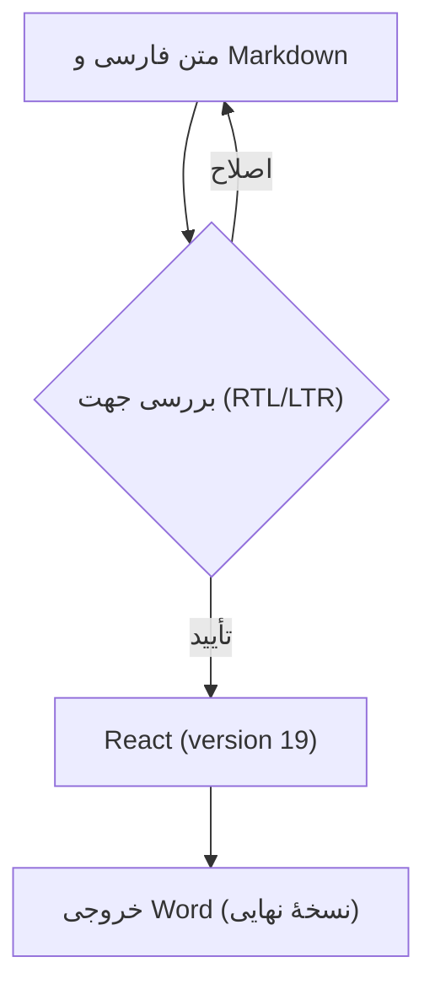
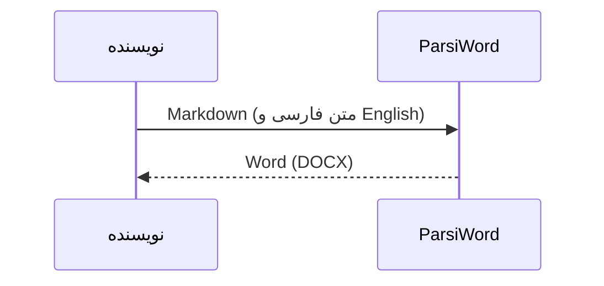

# فارسی و English؛ کنار هم

## پرانتز، عدد و تغییر جهت

کتابخانهٔ React (version **19**) را نصب کنید.

این پروژه (React و TypeScript) روی اندروید اجرا می‌شود؛ نتیجه (مرحلهٔ اول (نسخهٔ آزمایشی)) تأیید شد.

قیمت محصول (**250** USD)، تخفیف 25% و مبلغ نهایی (۱۸۷٫۵۰ دلار) ثبت شد؛ شناسهٔ سفارش AB-123/۴۵۶ است.

توضیح **(متن پررنگ و React 19)**، *متن مورب (تکمیلی)* و ~~نسخهٔ قدیمی (v1.0)~~ را کنار هم ببینید.

این جمله عمداً بلند است تا روی صفحهٔ باریک گوشی چند خط شود: کتابخانهٔ [React (version **19**)](https://react.dev/) را نصب کنید و نتیجهٔ پردازش (مرحلهٔ دوم [خروجی {نسخهٔ آزمایشی}]) را با متن اصلی مقایسه کنید؛ پایان جمله باید همین‌جا باشد.

English starts here (نسخهٔ فارسی (مرحلهٔ دوم)) and continues with React (version 19), [item 2] and number 123.

## علامت‌های باز و بسته

فارسی (توضیح)؛ فارسی \[توضیح\]؛ فارسی {توضیح}؛ فارسی \<توضیح\>.

فارسی «نقل‌قول (تودرتو)»؛ فارسی 《عنوان (نسخهٔ ۲)》؛ فارسی 〈توضیح〉؛ فارسی ⟨توضیح⟩؛ فارسی 〔توضیح〕؛ فارسی 【توضیح】.

علامت‌های کم‌کاربرد: ⹕توضیح (فارسی)⹖ و ⹗React (version 19)⹘.

ترکیبی (React 19)؛ ترکیبی \[React 19\]؛ ترکیبی {React 19}؛ ترکیبی \<React 19\>؛ ترکیبی «React 19»؛ ترکیبی 《React 19》.

لایه‌های تودرتو: (بیرونی \[میانی {React (version **19**)}\]) و «گزارش 《مرحلهٔ دوم (build 42)》» تمام شدند.

نشانه‌های کنار متن: فارسی: React 19؛ انگلیسی؟ بله! ایمیل user@example.com و تاریخ 2026/10/22 (۱۴۰۵/۰۷/۳۰) ثبت شدند.

## جدول و فهرست

| مورد | مقدار | توضیح |
| --- | --- | --- |
| کتابخانه (نسخه) | React (version **19**) | آماده (مرحلهٔ اول) |
| مبلغ (USD) | 250.50 | پرداخت {شمارهٔ ۱۲۳} |
| فرمول | $E=mc^2$ | انرژی (E) |

1. دریافت متن (فارسی و English).
2. بررسی نتیجه \[React (version 19)\].
   - متن **پررنگ (تکمیلی)** و مسیر `C:\Users\Sara\report(19).md`.
   - کد `items[0].value ?? "(empty)"` و شرط `x < 10 && y > 2`.
3. ذخیرهٔ Word (نسخهٔ نهایی).

> نقل‌قول: «خروجی (مرحلهٔ اول) با React (version 19) آماده شد.» سپس متن فارسی ادامه دارد.

## کد؛ چپ‌به‌راست

```typescript
const data = { name: "React (version 19)", tags: ["RTL", "فارسی"] };
const result = data.tags.map((tag, i) => `[${i}] (${tag})`);
if (result.length < 10 && result.length > 0) {
  console.log("<result>", { result }, "</result>");
}
```

## فرمول LaTeX

در متن فارسی، کسر $\frac{a+b}{1+x^2}$ (با شرط $x>0$) کنار پرانتز قرار می‌گیرد؛ متن پس از فرمول ادامه دارد.

$$
\int_0^1 x^2\,dx=\frac{1}{3}
$$

$$
\left\{\sum_{k=1}^{n} k\right\}=\frac{n(n+1)}{2},\qquad \sqrt{a^2+b^2}
$$

## نمودار Mermaid





در بخش‌های بعد، همهٔ آزمون‌های سخت قبلی و نمونهٔ ۳۶ زبان کد آمده‌اند.
