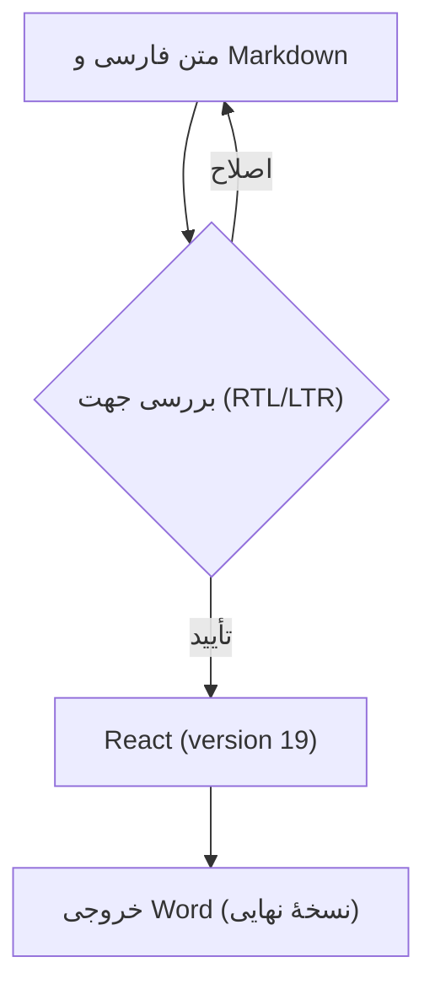
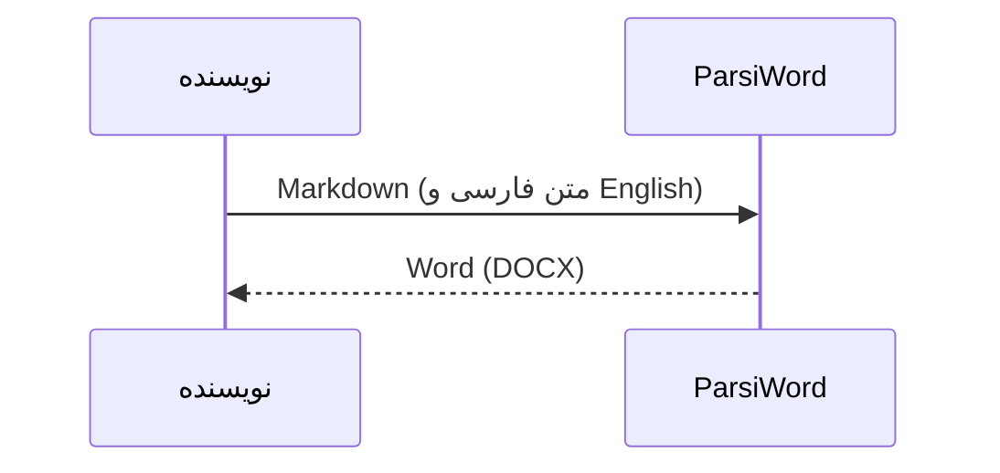

# فارسی و English؛ کنار هم

با پارسی‌ورد، Markdown راست‌به‌چپ را بنویس و همان‌جا ویرایش کن؛ از سؤال‌های هندسه با **TikZ** تا فرمول‌های پیشرفتهٔ **LaTeX**، جدول و نمودار.

Write and preview RTL Markdown, draw geometry with TikZ, and edit advanced LaTeX equations alongside Persian and English text.

## هندسه با TikZ؛ دایره، دو شعاع و یک سؤال

**صورت سؤال:** شعاع دایره $r=2$ و زاویهٔ بین دو شعاع $60^\circ$ است. طول وتر $AB$ را به دست آورید.

```tikz
\usetikzlibrary{angles,quotes,calc}
\begin{tikzpicture}[scale=1.3]
\coordinate (O) at (0,0);
\coordinate (A) at (2,0);
\coordinate (B) at (60:2);
\fill[blue!10] (O) -- (A) arc[start angle=0,end angle=60,radius=2] -- cycle;
\draw[blue!70!black,thick] (O) circle (2);
\draw[thick] (A) -- (O) -- (B);
\draw[red!75!black,thick,dashed] (A) -- (B) node[midway,right] {$x$};
\pic[draw,"$60^\circ$",angle radius=0.7cm] {angle=A--O--B};
\fill (O) circle (0.025) node[below left] {$O$};
\fill (A) circle (0.025) node[right] {$A$};
\fill (B) circle (0.025) node[above] {$B$};
\path (O) -- (A) node[midway,below] {$r=2$};
\end{tikzpicture}
```

کدِ همین شکل داخل فایل Markdown می‌ماند. زاویه، شعاع یا رنگ را عوض کن و نتیجه را در پیش‌نمایش ببین. برای ویرایش شکل در پیش‌نمایش، دکمهٔ «ویرایش نمودار TikZ» را بزن.

**راه‌حل با قانون کسینوس‌ها:**

$$
\begin{aligned}
AB^2 &= 2r^2(1-\cos\theta), \\
AB   &= 2r\sin\!\left(\frac{\theta}{2}\right), \\
     &= 4\sin 30^\circ = 2.
\end{aligned}
$$

## فرمول‌های پیشرفتهٔ LaTeX | Advanced equations

**انتگرال گاوسی و کامل‌کردن مربع**؛ یک فرمول چندخطی با کران بی‌نهایت، کسر و توان:

$$
\begin{aligned}
-ax^2+bx &= -a\left(x-\frac{b}{2a}\right)^2+\frac{b^2}{4a}, \\
\int_{-\infty}^{+\infty} e^{-ax^2+bx}\,dx
  &= \sqrt{\frac{\pi}{a}}\,e^{\frac{b^2}{4a}},\qquad a>0.
\end{aligned}
$$

**جبر خطی**؛ ماتریس دوران، ترانهاده و دترمینان در کنار متن راست‌به‌چپ:

$$
\begin{aligned}
\mathbf{R}_{\theta} &=
\begin{pmatrix}
\cos\theta & -\sin\theta \\
\sin\theta & \cos\theta
\end{pmatrix}, \\
\mathbf{R}_{\theta}^{\mathsf T}\mathbf{R}_{\theta} &= \mathbf{I},
\qquad \det(\mathbf{R}_{\theta})=1.
\end{aligned}
$$

**توابع ویژه و سری بی‌نهایت**؛ رابطهٔ گاما و بتا و مجموع مشهور بازل:

$$
\begin{aligned}
\Gamma(z) &= \int_0^{\infty} t^{z-1}e^{-t}\,dt,\qquad z>0, \\
B(p,q) &= \frac{\Gamma(p)\Gamma(q)}{\Gamma(p+q)},\qquad p,q>0, \\
\sum_{n=1}^{\infty}\frac{1}{n^2} &= \frac{\pi^2}{6}.
\end{aligned}
$$

در پیش‌نمایش، فرمول‌ها را هم می‌توانی ویرایش کنی؛ در خروجی Word نیز به‌صورت فرمول قابل ویرایش ذخیره می‌شوند. شکل TikZ در خروجی Word و PDF به‌صورت تصویر قرار می‌گیرد.

## پرانتز، عدد و تغییر جهت

کتابخانهٔ React (version **19**) را نصب کنید.

این پروژه (React و TypeScript) روی اندروید اجرا می‌شود؛ نتیجه (مرحلهٔ اول (نسخهٔ آزمایشی)) تأیید شد.

قیمت محصول (**250** USD)، تخفیف 25% و مبلغ نهایی (۱۸۷٫۵۰ دلار) ثبت شد؛ شناسهٔ سفارش AB-123/۴۵۶ است.

توضیح **(متن پررنگ و React 19)**، *متن مورب (تکمیلی)* و ~~نسخهٔ قدیمی (v1.0)~~ را کنار هم ببینید.

این جمله عمداً بلند است تا روی صفحهٔ باریک گوشی چند خط شود: کتابخانهٔ [React (version **19**)](https://react.dev/) را نصب کنید و نتیجهٔ پردازش (مرحلهٔ دوم [خروجی {نسخهٔ آزمایشی}]) را با متن اصلی مقایسه کنید؛ پایان جمله باید همین‌جا باشد.

English starts here (نسخهٔ فارسی (مرحلهٔ دوم)) and continues with React (version 19), [item 2] and number 123.

## علامت‌های باز و بسته

فارسی (توضیح)؛ فارسی \[توضیح\]؛ فارسی {توضیح}؛ فارسی \<توضیح\>.

فارسی «نقل‌قول (تودرتو)»؛ فارسی 《عنوان (نسخهٔ ۲)》؛ فارسی 〈توضیح〉؛ فارسی ⟨توضیح⟩؛ فارسی 〔توضیح〕؛ فارسی 【توضیح】.

علامت‌های کم‌کاربرد: ⹕توضیح (فارسی)⹖ و ⹗React (version 19)⹘.

ترکیبی (React 19)؛ ترکیبی \[React 19\]؛ ترکیبی {React 19}؛ ترکیبی \<React 19\>؛ ترکیبی «React 19»؛ ترکیبی 《React 19》.

لایه‌های تودرتو: (بیرونی \[میانی {React (version **19**)}\]) و «گزارش 《مرحلهٔ دوم (build 42)》» تمام شدند.

نشانه‌های کنار متن: فارسی: React 19؛ انگلیسی؟ بله! ایمیل user@example.com و تاریخ 2026/10/22 (۱۴۰۵/۰۷/۳۰) ثبت شدند.

## جدول و فهرست

| مورد | مقدار | توضیح |
| --- | --- | --- |
| کتابخانه (نسخه) | React (version **19**) | آماده (مرحلهٔ اول) |
| مبلغ (USD) | 250.50 | پرداخت {شمارهٔ ۱۲۳} |
| فرمول | $E=mc^2$ | انرژی (E) |

1. دریافت متن (فارسی و English).
2. بررسی نتیجه \[React (version 19)\].
   - متن **پررنگ (تکمیلی)** و مسیر `C:\Users\Sara\report(19).md`.
   - کد `items[0].value ?? "(empty)"` و شرط `x < 10 && y > 2`.
3. ذخیرهٔ Word (نسخهٔ نهایی).

> نقل‌قول: «خروجی (مرحلهٔ اول) با React (version 19) آماده شد.» سپس متن فارسی ادامه دارد.

## کد؛ چپ‌به‌راست

```typescript
const data = { name: "React (version 19)", tags: ["RTL", "فارسی"] };
const result = data.tags.map((tag, i) => `[${i}] (${tag})`);
if (result.length < 10 && result.length > 0) {
  console.log("<result>", { result }, "</result>");
}
```

## فرمول LaTeX

در متن فارسی، کسر $\frac{a+b}{1+x^2}$ (با شرط $x>0$) کنار پرانتز قرار می‌گیرد؛ متن پس از فرمول ادامه دارد.

$$
\int_0^1 x^2\,dx=\frac{1}{3}
$$

$$
\left\{\sum_{k=1}^{n} k\right\}=\frac{n(n+1)}{2},\qquad \sqrt{a^2+b^2}
$$

## نمودار Mermaid





در بخش‌های بعد، همهٔ آزمون‌های سخت قبلی و نمونهٔ ۳۶ زبان کد آمده‌اند.
